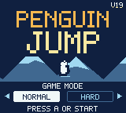
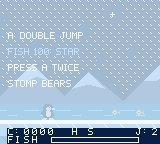
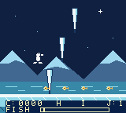
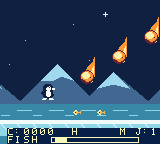

# Penguin Jump

ペンギンが氷原を走り、障害物を二段ジャンプでかわす **Game Boy Color専用**の横スクロールゲームです。コースは毎回変化し、ゲームオーバーまでの連続クリア数と集めた魚の数を競います。ModRetro Chromaticで遊べるROMと、GB Studioで編集できる制作ソースを収録しています。

**最新版: V19** — 吹雪・氷柱3倍・隕石3倍の特殊モードに対応。

[V19 ROMをダウンロード](https://github.com/everlast/PenguinJump/raw/refs/heads/main/build/PenguinJump-v19.gbc) · [検証記録](playtest/v19-verification.md) · [制作履歴](docs/DEVELOPMENT_HISTORY.md)

| タイトル | 吹雪 | 氷柱3倍 | 隕石3倍 |
|---|---|---|---|
|  |  |  |  |

## 遊び方

- 右への移動は自動。Aでジャンプし、空中で一度離してもう一度押すと二段ジャンプ。長押しで高く跳べます。
- 魚を集めると `FISH` ゲージがたまり、100匹ごとに一定時間無敵になります。無敵中は `STAR` ゲージで残り時間を表示します。
- コースをクリアするごとにスクロール速度とBGMのテンポが上がります。無敵中は専用BGMに切り替わります。
- **NORMAL** は1ステージ目相当から、**HARD** は20ステージ目相当から開始します。
- 氷、穴、浮遊ブロック、歩くしろくまが登場。熊は横からぶつかるとアウトですが、上から踏むと倒せます。
- 5ステージ目から雪玉、10ステージ目から氷柱、15ステージ目から黒熊と放物線を描くハンマー、20ステージ目から隕石が加わります。
- 氷柱と隕石の予兆表示はありません。これらの区間の魚は低い位置に配置しています。
- 永続セーブは未実装です。

### V19の特殊モード

20ステージ目以降、コース開始時に3種類を**それぞれ独立して10%で抽選**します。同時発生もあります。HARDは最初のコースから対象です。

| モード | 効果 | HUD |
|---|---|---|
| 吹雪 | 背景と登場物の視界が悪くなり、雪が流れる。HUDは読みやすさを維持 | `S` |
| 氷柱3倍 | 通常の1〜3区間で各3本、合計3〜9本の氷柱 | `I` |
| 隕石3倍 | 通常の隕石区間で3個の隕石 | `M` |

特殊モードでも他の障害物を減らしません。落下物をずらして配置し、熊の攻撃区間との重複を避けています。

### 操作

| 操作 | Game Boy Color / Chromatic | 標準ブラウザー入力 |
|---|---|---|
| タイトルでモード選択 | 左右、またはSELECT | ← / →、またはP |
| 開始 | A / START | Z / Enter |
| ジャンプ | A | Z |
| 二段ジャンプ | 空中でAを離して押し直す | 空中でZを離して押し直す |
| 一時停止 | START | Enter |
| 再開 | A / START | Z / Enter |
| ゲームオーバー後に再挑戦 | A | Z |
| ゲームオーバー後にメニューへ戻る | B | X |

## ROMと制作ソース

- [`build/PenguinJump-v19.gbc`](build/PenguinJump-v19.gbc): 最新ROM、131,072 bytes。初版〜V18も同じフォルダーに保存。
- [`project.gbsproj`](project.gbsproj) / `project/`: GB Studioの編集用プロジェクトとシーン・設定。
- `plugins/penguin-runner/`: 独自のゲーム処理、タイトルアニメーション、BGM制御。
- `assets/`: 登録済みの画像、フォント、UI、音楽。
- `art-source/`: ピクセルアートの生成元、素材検査スクリプト。
- `music-source/`: オリジナルBGMの音符・音色と生成元。編集可能なUGEファイルは `assets/music/`。
- `playtest/`: 実ROMの画面、検証レポート、公開用に整えた観測記録と実機書き込み結果。

V19のSHA-256:

```text
8c13344ace957985c83271bfd89643966908e7355f0ec4918bccee9b2a679929
```

## 編集・ビルド

制作時の環境は **GB Studio CLI 4.3.2 / GBDK 4.5.0 / エンジン4.3.0-e1**。GB Studioで `project.gbsproj` を開けます。独自の `PENGUIN` シーンタイプを使うため、プロジェクト内の `plugins/` も保持してください。

同じCLI環境で、プロジェクトルートから実行します。

```sh
gb-studio-cli make:rom project.gbsproj build/PenguinJump-v19.gbc
gb-studio-cli make:web project.gbsproj build/web
```

ModRetro Chromaticプラグインでは `project.gbsproj` を選択して `rom_build` / `web_preview` を使用できます。コンパイラーやエミュレーター本体はこのリポジトリには含めていません。素材の再生成にはPython/Pillow、BGMの再生成にはGB StudioのUGEシリアライザーを使います。詳細は [音楽のREADME](music-source/README.md) と [制作履歴](docs/DEVELOPMENT_HISTORY.md) を参照してください。

## 検証状況

- V19の公式ビルドとROMヘッダー検査は成功。
- PyBoyで3モード同時発生・氷柱9本・NORMALのコースをクリア。接触死、一時停止、メニュー復帰、色の復元も検査。
- 924回のスプライト走査線標本で、同時表示は最大9個。上限10個の超過なし。
- 実ソースのホスト検査は65,535シードで各モード約10%と全8組み合わせを確認。1,000コースで最大速度時の落下数と攻撃区間を検査。
- **2026-10-03、V19のChromaticへの書き込みは正常終了**。実機での起動・表示・音・操作はこの記録では未観測。
- V19のブラウザー表示は未確認。制作時の旧プレビューで終了応答不明が残ったため、V19はROMで検証しました。古いWeb出力は収録していません。

最新の [検証レポート](playtest/v19-verification.md)、[実機書き込み記録](playtest/flash-v19.md)、[公開記録の範囲](playtest/README.md) を参照してください。ソースの抽選・配置検査はmacOSのXcode Command Line ToolsとPython 3で実行できます。

```sh
python3 playtest/check_v19_weather.py
```

## 素材とライセンス

ペンギン、魚、各種障害物、タイトル、背景、HUD、BGMはこのゲームの制作素材です。標準フォント・枠などGB Studioのblank project付属素材に伴う [MITライセンス](LICENSE) と著作権表示を保持しています。

このリポジトリは公開用に整理した制作物です。個人用絶対パス・接続トークンは置換し、巨大な録画フレーム・一時ビルド・セーブ状態・ローカル配布ZIPは含めていません。制作元の記録はローカルに保持しています。
